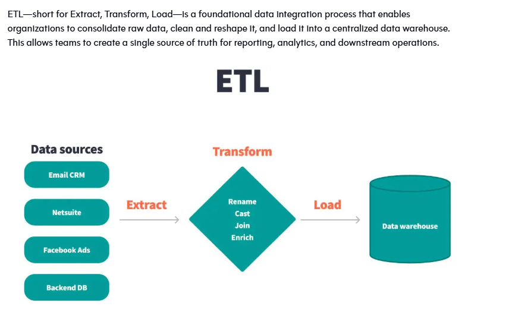

# Data-Engineering-101 
**Project architecture**


## 1. Description
This repo is a hands-on guide to learning modern data engineering by building a small end-to-end ETL pipeline: fetching data from an API, transforming it, and loading it into a relational database (PostgreSQL).


## 2. Getting Started

### 2.1 Prerequisites
1. Install Python (developed with Python 3.13.x)
2. Create a virtual environment (the built-in `venv` module is enough, no extra install needed)
   - Create a dedicated folder for your virtual env at the repo root: `mkdir virtual-env`
   - Create the virtual env inside it: `python -m venv virtual-env\space-env`
   - Add `virtual-env/` to `.gitignore` so it is never committed
   - Activate it from the root folder (PowerShell): `virtual-env\space-env\Scripts\Activate.ps1`
   - If activation is blocked, run once: `Set-ExecutionPolicy -Scope CurrentUser -ExecutionPolicy RemoteSigned`
   - (Alternative for cmd.exe): `virtual-env\space-env\Scripts\activate.bat`
3. Install dependencies from `requirements.txt` (run from your activated virtual env):
   - `pip install -r requirements.txt`
4. Save `requirements.txt` for reproducibility (run from `part-1`):
   - `pip freeze > requirements.txt`
5. Set up `part-1/src/config/config.ini` based on `config.ini.template`, filling in your own API URL, paths, and database credentials.

### 2.2 Run It
After setting up your environment and config, run the pipeline entry points from `part-1/src`:

```bash
python main_fetch_save.py    # fetches data from the API and saves timestamped CSVs to input/
python main_transform.py     # merges and cleans new CSVs, saves result to output/
python main_load_db.py       # loads the cleaned data into PostgreSQL
```

## 3. Src Walkthrough

### 3.1 Overview
- `input/` and `output/` represent our source and target file systems for the raw and curated layers.
- `src/` contains the pipeline entry points (`main_fetch_save.py`, `main_transform.py`, `main_load_db.py`) along with the `config/` and `util/` packages.
- `config/` holds configuration files (`config.ini`, `registry.txt`).
- `util/` holds all reusable logic: API access, file handling, transformation, database access, scheduling, and shared exceptions.

### 3.2 Util Package

#### 3.2.1 API Handler (`api_handler.py`)
Calls the configured API (Mockaroo) and saves the raw response as a timestamped CSV in `input/`. Logs the elapsed time of the API call for basic performance visibility. Raises `ApiRequestException` on network errors, non-200 responses, or file write failures.

#### 3.2.2 Config Handler (`config_handler.py`)
Centralizes all configuration reads from `config.ini` via `configparser`. Exposes typed getters (`get_api_url`, `get_input_dir`, `get_output_dir`, `get_registry_file`, `get_db_config`) and raises `InvalidValueException` on missing or empty values.

#### 3.2.3 Data Transformer (`data_transformer.py`)
Merges the new (not yet processed) CSV files found in `input/` into a single DataFrame, applies cleaning rules (deduplication, whitespace trimming, normalization of email/country/gender fields, missing-value handling, type coercion), and saves the cleaned result as a timestamped CSV in `output/`. Raises `FileHandlingException` on read, merge, or write errors.

#### 3.2.4 DB Handler (`db_handler.py`)
Manages the PostgreSQL connection lifecycle (`connect`, `close`), creates the `employees` table if it doesn't exist, and upserts a cleaned DataFrame into it using `ON CONFLICT ... DO UPDATE`. Raises `DBConnectionException` or `DBQueryException` as appropriate.

#### 3.2.5 File Handler (`file_handler.py`)
Tracks which files in `input/` have already been processed, using `registry.txt` as a persistent log. Supports listing new `.csv` files, loading/creating the registry, and appending newly seen filenames with a timestamp.

#### 3.2.6 Scheduler (`scheduler.py`)
Orchestrates recurring **ingestion** runs using the `schedule` library, periodically calling `ApiHandler.get_data_to_csv` and `FileHandler.track_new_files`. Wraps each job in a `_safe_run` helper so a single failing job doesn't crash the whole scheduling loop. The transform and load steps are not scheduled: they are run manually through `main_transform.py` and `main_load_db.py`. (For production-grade orchestration, a tool like Airflow would replace this.)

#### 3.2.7 Exceptions (`exceptions.py`)
Defines a shared exception hierarchy (`ProjectBaseException` and subclasses: `ApiRequestException`, `InvalidValueException`, `FileHandlingException`, `RegistryException`, `DBConnectionException`, `DBQueryException`) used consistently across all modules for predictable error handling.

### 3.3 Config Package

#### 3.3.1 Registry (`registry.txt`)
Contains the list of already-processed input files (filename + timestamp), used to avoid reprocessing and to keep an audit trail.

#### 3.3.2 config.ini
Holds all configuration, currently structured as:
- `[API]`: API URL (`url`)
- `[Paths]`: `input_dir`, `output_dir`, `registry_file`
- `[Database]`: PostgreSQL connection details (`host`, `port`, `dbname`, `user`, `password`)

Use the same structure as `config.ini.template`, filling in your own values. **Never commit real credentials**: `config.ini` should be gitignored.

### 3.4 Pipeline Layers
- **Raw layer**: fetch data from the API and store it as timestamped CSVs in `input/`.
- **Curated layer**: merge and clean new files from `input/` into a single cleaned CSV in `output/`.
- **Load layer**: upsert the curated data into PostgreSQL.

## 4. Testing

### 4.1 Unit Tests
Testing is done with `pytest`, using `unittest.mock` for isolation (mocking `requests`, `psycopg2`, `ConfigHandler`, `schedule`, etc.) and `tmp_path` fixtures for real, disposable file I/O where relevant.

Test files live under `part-1/src/util/test/` and cover:
- **`test_api_handler.py`**: successful fetch, HTTP errors, network errors, timeouts, file write errors, correct URL usage.
- **`test_config_handler.py`**: successful reads, missing sections/options, empty values, value stripping.
- **`test_data_transform.py`**: CSV loading and merging, cleaning rules (dedup, normalization, missing values, type coercion), empty-input handling, save errors.
- **`test_db_handler.py`**: connection success/failure, table creation, upsert logic, rollback on query errors.
- **`test_file_handler.py`**: listing CSVs, registry creation/loading/updating, new-file tracking.
- **`test_scheduler.py`**: safe job execution, error isolation, job scheduling and loop resilience.

Run the full suite from `part-1/src` (the same folder used to run the pipeline):
```bash
pytest -v
```

Run a specific file:
```bash
pytest util/test/test_api_handler.py -v
```

## 5. Development Workflow

### 5.1 .gitignore
For files that are already tracked and should be ignored going forward, untrack them first, then commit:
```bash
git rm -r --cached <file-or-folder-path>   # use -r for folders
```

### 5.2 Moving or Renaming Files
When moving files (for example, images into `img/`), use `git mv` so Git records a rename instead of a delete plus an untracked file:
```bash
git mv DataEngLifeCycle.png img/
git mv "project architecture.png" img/
```
If you already moved them by hand, run `git add -A <old-paths> img/` and Git will detect the rename. Remember to update any image links in this README.

### 5.3 Branching & Pull Requests
This repo uses **two branches on purpose**, just to get familiar with the Pull Request (PR) workflow:

- `main`: the stable branch. Nothing is committed to it directly; it only changes through merged PRs.
- `ysf`: my working branch. All commits go here first.

The cycle:
1. Switch to the working branch and make changes:
   ```bash
   git checkout ysf
   # edit files, then:
   git add .
   git commit -m "Describe the change"
   git push origin ysf
   ```
2. Open a Pull Request on GitHub with **base: `main`** and **compare: `ysf`**, with a clear title and description.
3. Review the diff in the PR, then merge it into `main` (prefer **Squash and merge** for a clean, linear history).
4. **Do not delete `ysf` after merging**, since it is reused for the next PR. Instead, resync it with `main`:
   ```bash
   git checkout ysf
   git fetch origin
   git reset --hard origin/main    # safe only if everything on ysf was already merged
   git push --force-with-lease origin ysf
   ```
   (After a squash merge, `ysf` and `main` have different commit histories, so a plain `git merge origin/main` can cause confusing conflicts. If you used a regular merge commit instead of a squash, `git merge origin/main` is enough.)

Good habits to practice along the way:
- Keep each PR focused on a single change.
- Pull `main` into `ysf` regularly to avoid large conflicts:
  ```bash
  git fetch origin
  git merge origin/main
  ```
- On a team project you would use short-lived feature branches instead (e.g. `feature/db-upsert`, `fix/config-encoding`) and delete them after merging.

## 6. Clean-Up

### 6.1 Delete Generated Files
Make sure you're in the repo root directory:
```bash
rm ./part-1/input/*.csv
rm ./part-1/output/*.csv
```

## 7. Roadmap / TODO
- [ ] Ensure code complies with Python best practices (naming, typing where useful)
- [ ] Replace the custom `Scheduler` with a proper orchestrator (e.g. Airflow) for production use
- [ ] Schedule the transform and load steps as well, not just ingestion

## Pipeline Overview

```
[Scheduler]  (ingestion only)
     │
     ▼
Every N seconds/minutes
     │
     ▼
[ApiHandler] ──► calls Mockaroo API ──► saves timestamped CSV in input/
     │
     ▼
[FileHandler] ──► scans input/ for .csv files ──► compares with registry.txt ──► logs new files

─────────── run manually from here ───────────

[DataTransformer] ──► merges & cleans new CSVs ──► saves curated CSV in output/
     │                (main_transform.py)
     ▼
[DBHandler] ──► upserts curated data into PostgreSQL
                (main_load_db.py)
```

**ETL Pipeline**


